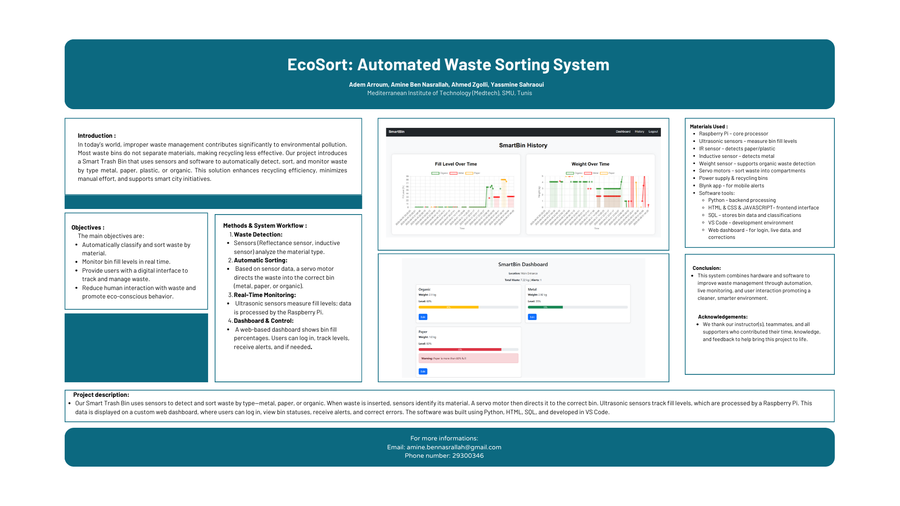
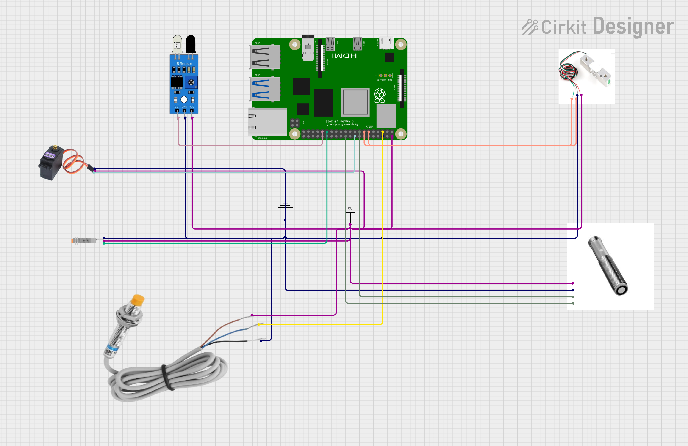
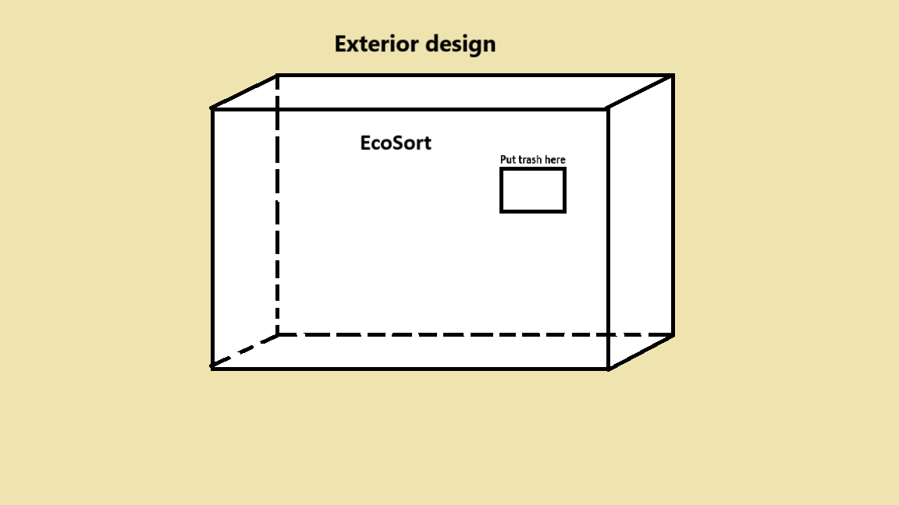

# ♻️ EcoSort: Smart Waste-Sorting Bin

A smart bin that **detects, sorts and monitors waste automatically**. A Raspberry Pi reads a set of sensors to identify each item (metal, paper, organic, plastic), drives servo flaps to drop it into the right compartment, and logs fill level and weight to a **Flask web dashboard**.

Sophomore engineering project (ISS296) at MedTech – South Mediterranean University, built by a team of 4.



## How it works

1. An **IR sensor** detects an item at the bin's entrance.
2. The item is classified:
   - **Inductive proximity sensor** → metal
   - **Reflectance sensors (QTR-8RC)** → paper vs organic
3. **Servo motors** (driven through a PCA9685 board) open the flap of the matching compartment.
4. **Ultrasonic sensors (HC-SR04)** measure each compartment's fill level; a **load cell + HX711** measures weight.
5. Readings are sent to the **Flask** server, stored in **MySQL**, and shown on the dashboard, with an alert when a bin is almost full.

## Features

- Real-time dashboard: fill level and weight per compartment
- History page with charts (Chart.js / Matplotlib) of waste accumulated over time
- Manual edit of readings as a fallback when a sensor misbehaves
- Login-protected admin interface
- Fill-level threshold alerts (90 %)
- 3D prototype of the bin designed in **SolidWorks**

## Hardware

| Part | Role |
|---|---|
| Raspberry Pi 4 | Main controller |
| IR sensor | Detects an item at the entrance |
| LJ12A3-4-Z inductive sensor | Metal detection |
| QTR-8RC reflectance sensor | Paper vs organic |
| HC-SR04 ultrasonic sensors | Fill level of each compartment |
| Load cell + HX711 | Waste weight |
| SG90 / MG996R servos + PCA9685 | Open the sorting flaps |

<p>
  
  
</p>

## Repository structure

```
web/                 Flask back-end + HTML templates (dashboard, history, login, edit)
raspberry-pi/        Sensor reading, classification and servo control scripts
hardware/            Circuit diagram, component list and build photos
docs/                Poster and final report
```

## Run the web dashboard

```bash
pip install flask flask-mysqldb pandas matplotlib numpy
export MYSQL_PASSWORD="your_mysql_password"
export FLASK_SECRET_KEY="any-random-string"
export ADMIN_PASSWORD="choose-a-dashboard-password"
python web/app.py
```

Create a MySQL database named `smartbin_db` with the tables `bin_info`, `compartments` and `compartment_log`.

On the Raspberry Pi: `python raspberry-pi/sorting_controller.py` (requires `RPi.GPIO`, `hx711`, `adafruit-circuitpython-pca9685`).

## Tech stack

Python · Flask · MySQL · HTML/CSS/JS · Chart.js · Matplotlib · Raspberry Pi · RPi.GPIO · SolidWorks

## Team

Amine Ben Nasrallah · Adem Arroum · Ahmed Amine Zgolli · Yasmine Sahraoui. Advisor: Yassine Chaouch.

📄 Full details in the [final report](docs/final-report.pdf).
